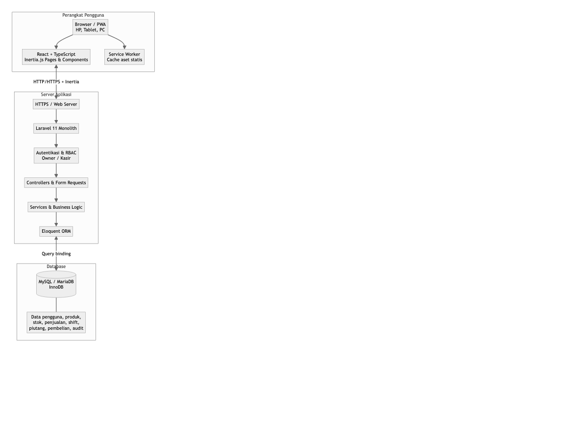
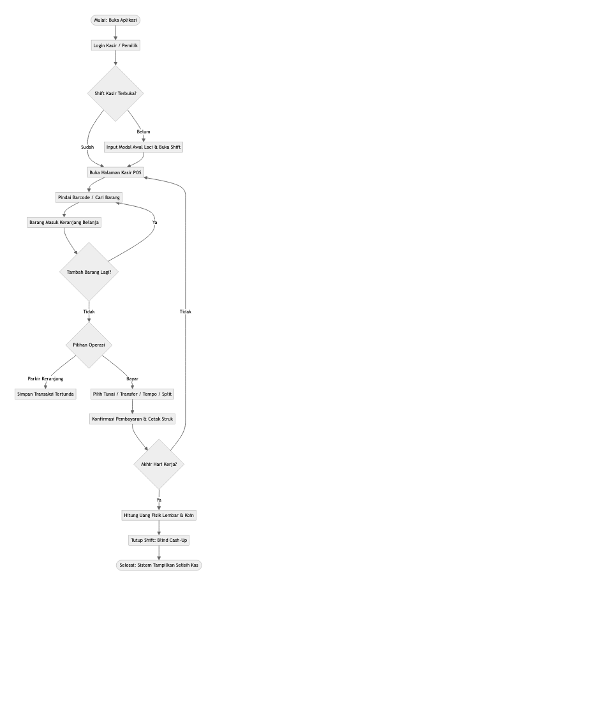
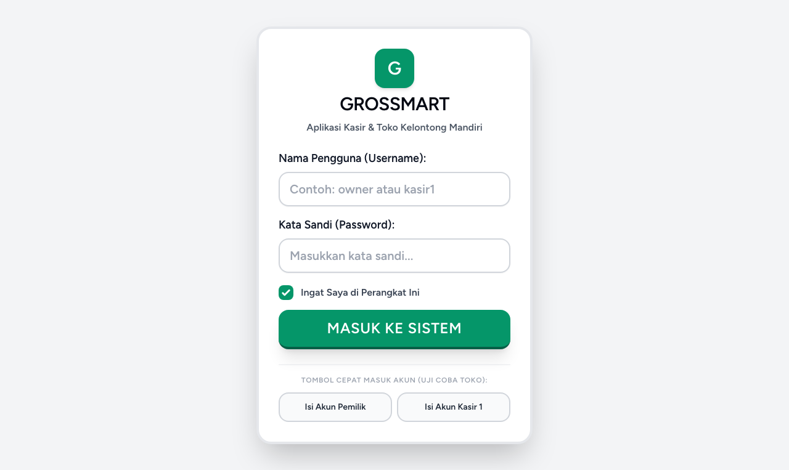
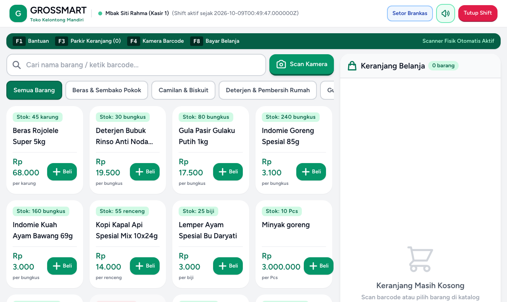
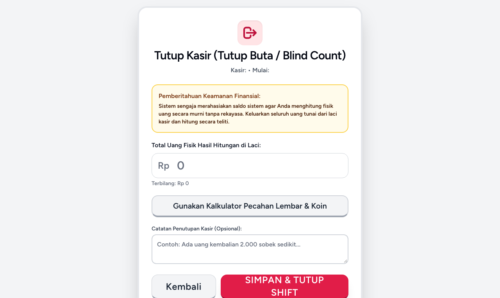
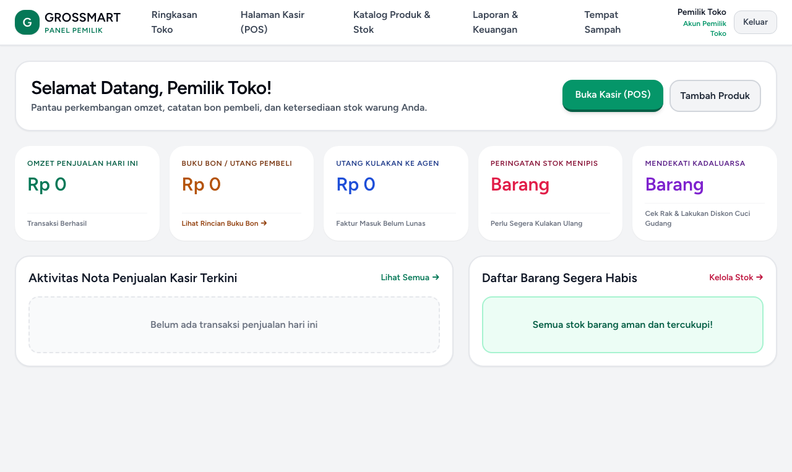
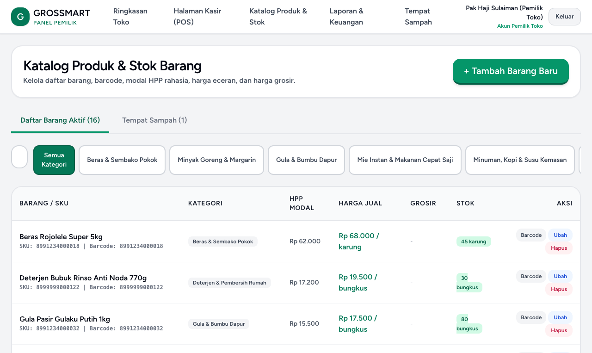

# GROSSMART: APLIKASI KASIR DAN PENGELOLAAN OPERASIONAL TOKO KELONTONG YANG RAMAH PENGGUNA LANJUT USIA

Disusun Oleh :

| Nama | Nim |
| --- | --- |
| [DUMMY_REPLACE: Muhammad Fakhri Al-Faruq] [DUMMY_REPLACE: Budi Prasetyo Utomo] [DUMMY_REPLACE: Siti Rahmawati Dewi] | [DUMMY_REPLACE: 220535601234] [DUMMY_REPLACE: 220535602345] [DUMMY_REPLACE: 220535603456] |

Universitas Bina Sarana Informatika  
2026

## ABSTRAK
Toko kelontong mandiri (~3,9 juta unit di Indonesia) menyediakan kebutuhan pokok harian warga permukiman secara dekat dan terjangkau. Namun, keberadaannya kian terdesak oleh jaringan minimarket waralaba modern yang didukung sistem kasir otomatis. Sebagian besar pengelola warung tradisional berusia paruh baya hingga lanjut usia yang masih mengandalkan pencatatan manual di buku kertas, nota sobekan, dan kalkulator saku. Cara manual ini menimbulkan berbagai persoalan harian: antrean jam sibuk melambat, rawan selisih uang laci malam hari, catatan bon utang langganan terselip, dan pembukuan makanan titipan warga sering keliru. Aplikasi kasir komersial di pasaran umumnya mematok biaya sewa bulanan yang memberatkan margin tipis warung, menggunakan antarmuka berhuruf kecil yang rumit bagi lansia, serta tidak menyediakan alur tutup kasir buta (*blind cash-up*). Proposal ini mengusulkan **Grossmart**, aplikasi web kasir operasional mandiri (*self-hosted*) berbasis *Laravel 11*, *React 18*, *Inertia.js*, dan *MySQL InnoDB* yang dirancang khusus memenuhi kebutuhan warung tradisional. Grossmart memadukan antarmuka ramah lansia berstandar *WCAG 2.1 AAA* (tombol sentuh lebar >56px, kontras tinggi, tombol cepat pecahan Rupiah, isyarat suara), alur tutup kasir buta dengan kalkulator hitung fisik uang Rupiah tanpa saldo terbuka di layar, konversi otomatis kemasan dus ke eceran (*repack*), pencatatan bon utang langganan, serta fondasi data makanan titipan warga. Uji coba fungsional via *PHPUnit* dan pengujian lapangan pada toko mitra disiapkan untuk memvalidasi bahwa Grossmart mampu memangkas waktu rekap harian dari 60 menit menjadi <15 menit, meminimalkan selisih kas laci, serta mencapai skor *System Usability Scale* (SUS) > 75 pada kasir lansia.

**Kata kunci:** toko kelontong, aplikasi kasir, ramah lansia, tutup kasir buta, transformasi digital.

## Judul

Proposal ini mengusung judul: **"Grossmart: Aplikasi Kasir dan Pengelolaan Operasional Toko Kelontong yang Ramah Pengguna Lanjut Usia"**.

Judul tersebut merangkum tiga fokus utama sistem:
1. **Objek dan Sasaran Solusi:** Toko kelontong mandiri tradisional, dengan fokus kemudahan bagi pemilik dan kasir lansia (50 tahun ke atas) yang mengalami penurunan daya lihat dan kelenturan gerak jari.
2. **Pendekatan dan Pemanfaatan Teknologi:** Aplikasi web monolitik modern berbasis *Laravel 11*, *React 18*, *Inertia.js*, dan *MySQL InnoDB*, berformat *Progressive Web App* (PWA) lokal mandiri tanpa biaya sewa bulanan.
3. **Tujuan dan Dampak Nyata:** Mencegah salah hitung kembalian, meniadakan selisih kas laci lewat tutup kasir buta (*blind cash-up*), merapikan catatan bon utang langganan dan fondasi pencatatan barang titipan warga, serta mewujudkan kemandirian digital bagi usaha mikro tradisional.

## Latar Belakang

Toko kelontong mandiri menjadi penopang utama perputaran belanja harian warga di kawasan permukiman. Data Asosiasi Pedagang mencatat sekitar 3,9 juta warung kelontong menopang distribusi sembako nasional. Namun, keberadaannya kian terdesak oleh jaringan minimarket waralaba modern dengan sistem kasir otomatis dan pengelolaan stok terpusat. Sebagian besar warung tradisional dikelola pedagang paruh baya hingga lanjut usia yang mengandalkan pembukuan kertas manual.

Hasil observasi lapangan pada toko mitra kami di RPTRA Jatinegara (unit gerai/koperasi kelontong komunitas warga, Jl. Swadaya No.12A 7, RT.7/RW.14, Jatinegara, Kec. Cakung, Jakarta Timur, beroperasi selama 10 tahun) yang dikelola oleh [DUMMY_REPLACE: H. Bambang Sudarsono] (58 tahun), mengidentifikasi empat kendala operasional utama:
1. **Mata Cepat Lelah dan Risiko Salah Pencet Tombol:** Kasir lansia kerap mengalami penurunan daya lihat jarak dekat (rabun dekat) serta kelenturan jari yang berkurang. Layar kalkulator kecil menyulitkan pembacaan angka saat jam ramai pembeli. Salah ketik nominal (misalnya Rp 10.000 terpencet Rp 100.000) atau salah kembalian langsung merugikan toko.
2. **Kelelahan Rekap Malam dan Selisih Uang Laci:** Saat toko tutup pukul 21.00 WIB, pemilik menghabiskan 45–60 menit mencocokkan tumpukan nota kertas dengan uang tunai di laci kasir. Rekap manual dalam kondisi lelah kerap menimbulkan selisih uang laci yang sulit dilacak.
3. **Pencatatan Bon Utang Langganan yang Rawan Rusak dan Hilang:** Belanja tempo (bon utang) adalah bentuk relasi sosial khas warung bagi tetangga sekitar. Namun, buku catatan kertas mudah basah, sobek, atau terselip. Pemilik kesulitan memantau total utang yang belum lunas dan tanggal jatuh tempo, sehingga modal belanja kulakan sering terganggu.
4. **Kerumitan Pembukuan Makanan Titipan Warga (Konsinyasi):** Warung menjadi andalan warga sekitar untuk menitipkan makanan olahan rumahan (seperti kue basah, kerupuk, atau gorengan). Selama ini, jumlah titipan datang, barang laku, sisa retur, dan bagi hasil hanya dicatat di secarik kertas lepas yang rawan tercecer atau keliru hitung.

Aplikasi kasir komersial di pasaran belum cocok untuk warung kelontong karena mematok biaya sewa bulanan (*SaaS*) yang menggerus margin tipis pedagang, menyajikan menu rumit bagi orang tua, serta tidak memiliki mekanisme tutup kasir buta. **Grossmart** dikembangkan sebagai sistem kasir mandiri (*self-hosted*) yang memadukan pencatatan transaksi serentak yang aman (ACID) bebas biaya sewa, perlindungan kas laci lewat tutup kasir buta, dan antarmuka ramah lansia.
### Rumusan Masalah
1. Bagaimana merancang sistem kasir terpadu yang memadukan transaksi cepat, pencatatan bon utang langganan, dan penataan data makanan titipan warga dalam satu basis data relasional yang konsisten?
2. Bagaimana menerapkan kontrol kasir melalui tutup kasir buta (*blind cash-up*) dan catatan riwayat (*audit log*) guna meniadakan selisih uang laci serta mencegah salah hitung maupun manipulasi data?
3. Bagaimana membangun tampilan antarmuka ramah lansia berstandar *WCAG 2.1 AAA* dengan tombol sentuh lebar, tulisan kontras tinggi, dan isyarat suara yang mudah dipakai kasir lanjut usia?

### Batasan Masalah
1. **Lingkup Entitas:** Difokuskan pada operasional satu toko fisik mandiri dengan sistem akun lokal (pemilik dan kasir); tidak mencakup jaringan multi-cabang atau waralaba korporat.
2. **Infrastruktur Jaringan:** Beroperasi pada arsitektur web mandiri via jaringan lokal toko (Wi-Fi/LAN) atau peladen privat; verifikasi transaksi diproses terpusat di peladen.
3. **Penyimpanan Transaksi:** *Service Worker* PWA difungsikan untuk pemuatan cepat aset statis; setiap pembayaran kasir diverifikasi peladen guna menjamin integritas stok dan kas laci.

## Tujuan dan Manfaat Aplikasi

### Tujuan Aplikasi
Tujuan rekayasa perangkat lunak Grossmart adalah:
1. **Membangun Sistem Kasir Operasional Mandiri:** Mengembangkan aplikasi web berbasis *Laravel 11*, *React 18*, *Inertia.js*, dan *MySQL InnoDB* yang memadukan transaksi kasir cepat, pengelolaan stok, pembukuan bon utang langganan, serta fondasi data barang titipan warga tanpa biaya sewa bulanan.
2. **Menghadirkan Perlindungan Uang Laci lewat Tutup Kasir Buta (*Blind Cash-Up*):** Menerapkan mekanisme tutup kasir di mana saldo akhir sistem disembunyikan dari layar kasir, mewajibkan kasir menghitung fisik uang tunai lembar per lembar pada kalkulator pecahan Rupiah demi menjaga keteraturan dan kejujuran laci kasir.
3. **Menerapkan Standar Kemudahan bagi Kasir Lansia (*WCAG 2.1 AAA*):** Merancang antarmuka ergonomis dengan tombol sentuh minimal 56–64px, huruf dan angka kontras tinggi hingga 44px, tombol cepat lembaran Rupiah, serta isyarat suara penanda aksi bagi kasir berusia 50 tahun ke atas.
4. **Memvalidasi Keandalan Sistem dan Kepuasan Pengguna:** Menguji keandalan pencatatan transaksi serentak lewat uji kode otomatis *PHPUnit*, serta mengukur kemudahan penggunaan langsung di warung mitra hingga mencapai target skor *System Usability Scale* (SUS) > 75.

### Manfaat Aplikasi
1. **Bagi Pemilik Warung Kelontong:** Memangkas waktu rekap malam dari 60 menit menjadi <15 menit; mencegah selisih uang laci tanpa jejak; memantau stok menipis dan peringatan barang habis; serta mengamankan perputaran modal usaha lewat catatan bon utang yang tertib.
2. **Bagi Kasir Berusia Lanjut:** Mengurangi ketegangan mata dan rasa panik saat melayani pembeli di jam ramai; mencegah salah hitung kembalian lewat tombol uang pas dan pecahan Rupiah; serta melindungi nama baik kasir dari kecurigaan selisih laci.
3. **Bagi Warga Penitip Dagangan:** Memberikan kepastian hitungan barang titipan yang laku dan pembagian hasil penjualan yang rapi serta tepat waktu.
4. **Bagi Kemandirian Digital Usaha Mikro:** Menjadi model penerapan teknologi tepat guna bagi warung kelontong mandiri berbasis perangkat lunak terbuka dan kendali penuh atas data transaksi toko sendiri.

## Tinjauan Singkat dan Posisi Kebaruan

Aplikasi mesin kasir digital (*Point of Sale* / POS) komersial di Indonesia umumnya berorientasi pada kafe, restoran, butik pakaian, atau minimarket waralaba. Karakteristik warung kelontong tradisional—perputaran uang receh, margin tipis sembako, buku bon utang warga, dan kasir lansia—kerap luput dari perancangan sistem komersial.

Berikut tinjauan kritis terhadap lima penyedia aplikasi kasir di Indonesia:
1. **Moka POS (PT Moka Teknologi Indonesia):** Menawarkan fitur analitik bisnis dan multi-cabang berbasis *cloud*. Biaya sewa bulanan (mulai Rp 299.000/bulan) sangat membebani warung. Ketergantungan pada tablet premium (iPad/Android kelas atas) dan tampilan padat menjadikannya tidak ramah bagi pedagang lansia.
2. **Majoo (PT Majoo Teknologi Indonesia):** Menyediakan paket aplikasi wirausaha lengkap (kasir, absensi, akuntansi). Kendalanya bagi warung adalah banyaknya menu kafe/resto yang tidak dibutuhkan sehingga membingungkan kasir lansia, skema sewa rutin, serta alur tutup kasir terbuka yang tidak mencegah manipulasi laci kasir.
3. **Kasir Pintar (PT Kasir Pintar Internasional):** Aplikasi kasir ponsel berskema gratis terbatas (*freemium*). Versi gratis membatasi kuota barang (maksimal 1.000 item), padahal variasi sembako warung mencapai 1.500–3.000 item. Layar ponsel sempit dengan tombol rapat menyulitkan jari kasir lansia sehingga rawan salah sentuh tombol (*fat-finger*), serta belum memiliki modul pembukuan jajan titipan warga.
4. **iReap POS (PT Sterling Tulus Cemerlang):** Solusi kasir ritel berbasis Android. Versi gratis tidak mendukung kasir multi-perangkat tersinkronisasi di satu toko, antarmukanya standar ritel umum tanpa penyesuaian untuk kasir lansia yang mengalami rabun dekat, dan tidak memiliki buku bon utang langganan.
5. **Pawoon (PT Pawoon Solusi Ritel):** Platform kasir berbasis *cloud* dengan sewa bulanan. Keterbatasannya mencakup keharusan sambungan internet tanpa henti, tidak ada fitur pemecahan kemasan eceran dari dus ke saset (*repack*), dan tiadanya alur tutup kasir buta.

### Analisis Kesenjangan Solusi
Terdapat empat kesenjangan utama antara solusi komersial dengan kebutuhan warung tradisional:
1. **Tiadanya Tutup Kasir Buta:** Aplikasi komersial menampilkan ringkasan uang masuk sebelum kasir menghitung fisik kas, membuka celah kasir menyamakan hitungan laci agar cocok dengan sistem.
2. **Beban Biaya Sewa Bulanan:** Skema langganan menyedot margin tipis warung. Pedagang membutuhkan solusi mandiri sekali pasang (*self-hosted*) tanpa biaya sewa berkala.
3. **Aksesibilitas Lansia Terabaikan:** Belum ada aplikasi komersial yang menerapkan standar *WCAG 2.1 AAA* dengan tombol sentuh lebar >56px, teks nominal besar hingga 44px, tombol cepat pecahan Rupiah, dan isyarat suara.
4. **Absennya Fitur Khas Warung:** Transaksi makanan titipan warga, buku bon utang langganan, dan pemecahan kemasan dus ke eceran belum terfasilitasi secara memadai.

Tabel 1 menyajikan perbandingan fitur antara solusi komersial dan Grossmart:

**Tabel 1. Komparasi Solusi Kasir Komersial dan Grossmart**

| Kriteria / Fitur Utama | Moka POS | Majoo | Kasir Pintar | iReap POS | Grossmart |
|---|---|---|---|---|---|
| **Model Biaya Layanan** | Sewa bulanan (Rp 299rb+) | Sewa bulanan (Rp 149rb+) | Freemium / sewa bulanan | Freemium / sewa bulanan | Mandiri (*Self-hosted*, Rp 0 sewa) |
| **Arsitektur Peladen** | *Cloud* vendor | *Cloud* vendor | *Cloud* vendor | *Cloud* vendor | Server lokal / privat mandiri |
| **Kendali Data Toko** | Terkunci di vendor | Terkunci di vendor | Terkunci di vendor | Terkunci di vendor | 100% kendali mandiri pemilik warung |
| **Desain Khusus Lansia** | Pengguna muda | Pengguna muda | Standar ponsel | Standar ritel umum | Ergonomis *WCAG 2.1 AAA* (Lansia) |
| **Tutup Kasir Buta** | Tidak ada | Tidak ada | Tidak ada | Tidak ada | Tersedia (*Blind cash-up*) |
| **Kalkulator Pecahan Rupiah** | Tidak ada | Tidak ada | Tidak ada | Tidak ada | Tersedia per lembar/koin Rupiah |
| **Jajan Titipan Warga** | Tidak ada | Terbatas | Tidak ada | Tidak ada | Skema data siap (roadmap UI lanjutan) |
| **Buku Bon Utang Langganan** | Terbatas (fitur tambahan / add-on) | Tersedia | Tersedia | Terbatas | Pencatatan bon kasir & pengingat WA |
| **Pecah Dus ke Eceran** | Perlu konfigurasi rumit | Perlu konfigurasi rumit | Tidak ada | Terbatas | Otomatis konversi stok eceran |
| **Proteksi Modal (HPP)** | Pengaturan peran | Pengaturan peran | Terbatas | Terbatas | Terkunci di tingkat peladen |

### Posisi Kebaruan (Novelty) Grossmart
Grossmart membawa empat kebaruan utama:
1. **Desain Ramah Kasir Lanjut Usia:** Mengadopsi tampilan yang nyaman dengan tombol sentuh besar (56–64px), kontras warna tinggi (rasio >7:1), tombol cepat pecahan resmi Rupiah, serta nada denting bel dan penanda audio (*beep*, *chime*, *buzz*) guna menuntun kasir lansia secara percaya diri.
2. **Perlindungan Kas Laci lewat Tutup Kasir Buta (*Blind Cash-Up*):** Kasir menghitung fisik uang tunai dan memasukkan jumlah lembaran ke kalkulator sistem tanpa melihat total saldo sistem di layar, sehingga pencocokan uang kas berlangsung jujur dan transparan bagi pemilik warung.
3. **Mengakomodasi Praktik Niaga Asli Warung:** Memfasilitasi fondasi data makanan titipan warga, pencatatan bon utang kasir terhubung pengingat WhatsApp, serta konversi stok dus ke saset eceran secara otomatis.
4. **Kemandirian Sistem dan Keamanan Data Toko:** Beroperasi sebagai aplikasi web pada perangkat lokal di warung, bebas biaya sewa berkala, dan menjamin kerahasiaan riwayat transaksi pedagang.

## Deskripsi dan Solusi Digital

Grossmart adalah aplikasi kasir berbasis web yang menggabungkan backend *Laravel 11*, antarmuka reaktif *React 18 TypeScript*, dan jembatan *Inertia.js*. Integrasi *Inertia.js* menghadirkan navigasi halaman tunggal yang gesit tanpa kerumitan pengelolaan API terpisah. Basis data *MySQL/MariaDB InnoDB* menjamin transaksi kasir patuh kaidah *ACID* (*Atomicity, Consistency, Isolation, Durability*).

### Arsitektur Sistem dan Pembagian Peran
Arsitektur Grossmart terbagi menjadi lima komponen terpadu (diagram lengkap pada **Gambar 1 di Lampiran 1**):
1. **Lapisan Antarmuka Pengguna:** Komponen *React 18* ramah lansia, tata letak multi-perangkat (komputer kasir, tablet, ponsel), pemindai barcode USB/kamera, dan isyarat suara *Web Audio API*.
2. **Lapisan Akselerasi Cepat (PWA):** *Service Worker* mandiri yang menyimpan aset statis antarmuka di peramban untuk pemuatan seketika tanpa jeda muat ulang.
3. **Lapisan Logika Bisnis (Backend Laravel 11):** Menangani validasi formulir sisi peladen, pembagian hak akses (*RBAC*), kalkulasi harga pokok penjualan (*HPP*) dan laba kotor berbasis *snapshot* modal transaksi, transaksi serentak ACID, dan catatan riwayat aktivitas (*audit log*).
4. **Lapisan Basis Data Relasional (MySQL InnoDB):** Menyimpan 31 tabel kebutuhan domain warung (plus 8 tabel framework Laravel) dengan penegakan integritas kunci asing (*foreign keys*) dan penguncian baris (*row locking*).
5. **Lapisan Pembatasan Hak Akses:** Membatasi wewenang Pemilik (*Owner*) dan Kasir (*Cashier*) via middleware `role:owner` dan method `$user->isOwner()` di model User.

**Tabel 2. Pemetaan Komponen Arsitektur Sistem Grossmart**

| Lapisan Sistem | Pilihan Teknologi | Peran Fungsional | Batasan Operasional |
|---|---|---|---|
| **Antarmuka Klien** | React 18 + TypeScript | Komponen kasir cepat, dialog pembayaran, tombol pecahan | Bergantung pada peramban modern (*Chromium/WebKit*) |
| **Akselerasi PWA** | *Service Worker* mandiri | Penyimpanan aset statis antarmuka untuk pemuatan instan | Tidak memproses transaksi simpan luring (*online-only verification*) |
| **Peladen Aplikasi** | Laravel 11 + Inertia.js | Pemrosesan aturan transaksi dan perhitungan kas toko, autentikasi sesi, validasi data | Memerlukan runtime PHP 8.2+ pada peladen lokal/privat |
| **Basis Data** | MySQL / MariaDB (InnoDB) | Penyimpanan persisten 31 tabel domain (plus 8 tabel framework), transaksi atomik ACID | Memerlukan *foreign key constraints* dan indeks aktif |
| **Keamanan Peran** | Middleware `role:owner` & User method | Isolasi data modal toko (HPP) dan laporan pemilik dari akses kasir | Pengecekan ditegakkan mutlak di level peladen (*server-side*) |

### Modul Fungsional Utama
Grossmart mengintegrasikan enam modul operasional inti:
1. **Modul Transaksi Kasir POS:** Pemindaian barcode cepat, pencarian nama barang praktis, simpan keranjang sementara (tombol F3 saat pembeli menambah belanjaan), serta dialog pembayaran dengan tombol uang pas dan pecahan lembaran Rupiah.
2. **Modul Shift dan Tutup Kasir Buta (*Blind Cash-Up*):** Buka shift dengan mencatat modal awal receh di laci, setor kas aman ke pemilik (*cash drop*) saat laci penuh, dan tutup shift di mana kasir menghitung lembar uang fisik tanpa melihat angka sistem.
3. **Modul Pengelolaan Barang dan Eceran (*Repack*):** Pengelolaan katalog sembako, harga grosir bertingkat, pemecahan kemasan dus ke saset eceran otomatis, serta pencatatan buku barang rusak dan kedaluwarsa.
4. **Fondasi Data Makanan Titipan Warga (Konsinyasi):** Skema data relasional untuk mencatat warga yang menitip, harga titip, komisi warung, dan bagi hasil penjualan yang disiapkan untuk tahap antarmuka lanjutan.
5. **Modul Buku Bon Utang Langganan (Piutang):** Pencatatan bon utang langsung di layar kasir, pengingat jatuh tempo via WhatsApp, dengan skema cicilan bertahap yang disiapkan pada basis data.
6. **Modul Dasbor dan Laporan Pemilik:** Ringkasan omzet harian, laba kotor toko, laporan selisih kas shift, mutasi keluar-masuk stok, serta rekaman audit operasional toko.

### Struktur 32 Model Domain Bisnis
Sistem mengelola 32 model Eloquent yang memetakan 31 tabel domain bisnis (plus 8 tabel framework Laravel):
- **Transaksi & Pembayaran:** `Sale`, `SaleItem`, `SalePayment`, `HeldCart`, `Sequence`.
- **Kasir & Kontrol Shift:** `CashierShift`, `CashDrop`, `AuditLog`, `AppSetting`.
- **Produk & Stok:** `Product`, `Category`, `ProductPriceTier` (harga grosir), `ProductUnitConversion` (konversi satuan eceran), `ProductBundle` (paket sembako), `StockMutation`, `StockConversion`, `SpoilageLog`.
- **Kulakan & Pembelian:** `Supplier`, `Purchase`, `PurchaseItem`, `SupplierPayablePayment`, `PurchaseReturn`, `PurchaseReturnItem`.
- **Pelanggan & Bon Utang:** `Customer`, `CustomerPointMutation`, `CustomerReceivable`, `ReceivablePayment`.
- **Makanan Titipan Warga:** `Consignor`, `ConsignmentSettlement`, `ConsignmentSettlementItem`.
- **Biaya & Pengguna:** `Expense`, `User`.
### Alur Kerja Operasional (User Flow)
Alur kerja harian dimulai pukul 06.00 WIB saat kasir masuk ke aplikasi (*login*) dan memasukkan modal awal uang receh di laci kasir. Kasir melayani transaksi penjualan atau mencatat bon utang belanjaan pelanggan tetap. Jika uang di laci menumpuk, kasir melakukan setor kas aman ke pemilik (*cash drop*). Pukul 21.00 WIB saat toko bersiap tutup, kasir menghitung lembar dan koin fisik uang laci pada kalkulator pecahan dan menekan tombol tutup shift. Pemilik warung kemudian memeriksa ringkasan omzet harian, memverifikasi selisih kas shift, dan meninjau log aktivitas sistem (**alur lengkap pada Gambar 2 di Lampiran 2**).

## Metodologi dan Rancangan Teknis

Pengembangan Grossmart menerapkan metodologi Rekayasa Perangkat Lunak Berpusat pada Pengguna (*Human-Centered Software Engineering Lifecycle*) dalam enam tahapan terstruktur:
1. **Analisis Kebutuhan & Pemodelan Domain:** Observasi mendalam pada warung mitra memetakan alur transaksi manual, kendala kas laci, dan praktik bon utang, menghasilkan spesifikasi kebutuhan, kamus data, dan *ERD* 39 tabel.
2. **Perancangan Antarmuka Ramah Lansia:** Penyusunan wireframe berstandar *WCAG 2.1 AAA* dengan tombol besar, tulisan kontras tinggi, palet warna tegas, dan isyarat audio penanda aksi.
3. **Pembangunan Kode dan Integrasi Sistem:** Pembangunan backend *Laravel 11*, frontend *React 18 TypeScript*, dan *Inertia.js*. Mengimplementasikan alur kasir cepat, tutup kasir buta, konversi stok eceran, penataan data makanan titipan warga, dan caching PWA *Service Worker* mandiri.
4. **Pengujian Fungsional Otomatis:** Penulisan uji otomatis *PHPUnit* guna memvalidasi transaksi di peladen: integritas transaksi serentak dan pengurangan stok di peladen melalui penguncian baris (*pessimistic row locking*), penolakan pembatalan nota (*void*) tanpa otorisasi sesi pemilik (RBAC `role:owner`), dan perhitungan selisih kas shift.
5. **Audit Keamanan Aplikasi dan Penguatan Peladen:** Pengujian terhadap kerentanan web (*OWASP Top 10*): mitigasi SQL injection via *Eloquent ORM*, pembersihan data tampilan anti-XSS via React, validasi token *CSRF*, otorisasi data antar pengguna, pembatasan laju login salah (*rate limiting*), dan isolasi data sensitif modal toko (*cost price*) di peladen agar terlindung dari akses kasir.
6. **Evaluasi Usability dan Uji Lapangan (Pilot):** Penerapan sistem di toko mitra menguji kemudahan kasir lansia via kuesioner baku *System Usability Scale* (SUS) serta mengukur efisiensi durasi rekap harian.
### Integritas Transaksi Atomik (ACID)
Setiap transaksi penjualan melibatkan pembaruan terpadu pada nota (`sales`), rincian belanja (`sale_items`), pembayaran (`sale_payments`), dan mutasi stok (`stock_mutations`). Logika ini dibungkus dalam transaksi basis data (`DB::transaction`). Jika terjadi gangguan sistem, seluruh operasi dibatalkan otomatis (*rollback*). Penguncian baris (*pessimistic row locking*) diterapkan pada stok barang guna menjamin akurasi kuantitas saat dua kasir melayani transaksi bersamaan.

### Autentikasi dan Otorisasi Berbasis Peran (RBAC)
Sistem menerapkan pembatasan hak akses langsung dari sisi peladen:
- **Peran Pemilik (*Owner*):** Akses penuh mengelola katalog sembako, harga modal belanja (HPP), laporan laba kotor, persetujuan pembatalan transaksi (*void*), pengaturan akun toko, dan peninjauan buku riwayat aktivitas (*audit log*).
- **Peran Kasir (*Cashier*):** Berfokus melayani penjualan, simpan keranjang sementara, buka shift laci, setor kas aman ke pemilik, dan tutup kasir buta. Seluruh halaman dan data modal kulakan dikunci rapat di tingkat peladen sehingga kasir tidak dapat melihat rahasia modal maupun laba toko.

## Analisis Kebutuhan Pengguna

Pengembangan Grossmart menempatkan kebiasaan nyata pedagang sebagai acuan desain. Profil persona berikut dirumuskan berdasarkan observasi di toko mitra:

**Tabel 3. Profil Persona Pengguna Toko Kelontong Grossmart**

| Parameter Persona | Persona 1: Pemilik Warung Kelontong (Owner) | Persona 2: Kasir Berusia Lanjut (Cashier) |
|---|---|---|
| **Identitas & Usia** | [DUMMY_REPLACE: H. Bambang Sudarsono] ([DUMMY_REPLACE: 58] tahun) | [DUMMY_REPLACE: Ibu Sumiyati] ([DUMMY_REPLACE: 61] tahun) |
| **Peran Operasional** | Pemilik warung, penanggung jawab keuangan & kulakan | Kasir operasional harian warung |
| **Karakteristik & Kebiasaan** | Mengelola unit usaha 10 tahun, teliti namun lelah rekap malam, terbiasa buku besar | Penglihatan rabun dekat karena usia, jari lambat mengetik, cemas jika salah hitung |
| **Kebutuhan Utama** | Rekap kas cepat <15 menit, kontrol selisih uang laci, pantau stok menipis | Huruf & angka besar jelas terbaca, tombol lebar gampang ditekan, kembalian otomatis |
| **Hambatan (*Pain Points*)** | Selisih kas tak terjelaskan, buku bon utang rusak, aplikasi POS sewa terlalu mahal | Tombol aplikasi kecil bikin salah pencet, takut dituduh curang saat uang laci kurang |

### Penerapan Standar Aksesibilitas WCAG 2.1 AAA Ramah Lansia
Guna mengatasi penurunan fungsi visual dan kelenturan jari kasir lansia, antarmuka Grossmart mematuhi standar *WCAG 2.1 AAA* melalui enam prinsip ergonomis:
1. **Skala Tipografi Ekstra Besar:** Teks barang minimal 16–20px berbobot tebal. Nominal total belanja dan kembalian disajikan sangat besar (32–44px, *font-extrabold*) agar jelas terbaca tanpa kacamata baca.
2. **Kontras Visual Tinggi (>7:1):** Menggunakan teks hitam (#111827) di atas putih (#FFFFFF), serta nominal belanja Hijau Zamrud (#047857) berkontras 7.5:1 terhadap latar belakang.
3. **Target Sentuh Lebar (>56px):** Tombol aksi utama (BAYAR, SIMPAN, CARI, HAPUS) dirancang setinggi 56–64px dengan jeda 16px (*gap-4*) guna mencegah salah sentuh tombol di sebelahnya (*fat-finger*).
4. **Tombol Cepat Pecahan Resmi Rupiah:** Menyediakan tombol instan **UANG PAS** dan tombol lembaran resmi Rupiah: **Rp 10.000**, **Rp 20.000**, **Rp 50.000**, dan **Rp 100.000** agar kasir tidak perlu mengetik nominal dari nol.
5. **Umpan Balik Nada Audio Penanda Aksi:** Mengintegrasikan isyarat suara fungsional via *Web Audio API*: nada *beep* saat barcode terpindai, denting bel (*chime*) saat transaksi berhasil, dan dengung (*buzz*) bila salah menekan tombol.
6. **Bahasa Warung Sehari-hari yang Akrab:** Menghindari istilah teknis asing yang membingungkan kasir dengan memakai kata-kata yang lazim di warung: *Batal Belanja*, *Parkir Keranjang*, *Bayar*, dan *Setor Kas ke Pemilik*.

Tabel 4 merangkum pemenuhan standar aksesibilitas WCAG 2.1 AAA pada Grossmart:

**Tabel 4. Kepatuhan Standar Aksesibilitas WCAG 2.1 AAA pada Grossmart**

| Kriteria Aksesibilitas | Standar WCAG 2.1 AAA | Implementasi Nyata pada Grossmart | Status Uji Teknis |
|---|---|---|---|
| **Ukuran Target Sentuh** | Minimal 44 x 44 piksel | Tombol kasir 56–64px dengan jarak pemisah 16px | Terpenuhi (Bebas salah pencet) |
| **Rasio Kontras Teks** | Minimal 7.0:1 untuk teks biasa | Teks hitam di atas putih (14:1); Zamrud total belanja (7.5:1) | Terpenuhi (Lolos uji kontras) |
| **Keterbacaan Huruf** | Ukuran teks proporsional | Teks barang 16–20px, nominal total belanja 32–44px tebal | Terpenuhi (Jelas tanpa kacamata) |
| **Pembeda Non-Warna** | Tidak bergantung warna saja | Tombol aksi menyertakan teks jelas, ikon, dan suara pembeda | Terpenuhi (Inklusif buta warna) |
| **Konfirmasi Aksi Bahaya** | Pencegahan kesalahan fatal | Dialog konfirmasi ganda sebelum pembatalan transaksi/nota | Terpenuhi (Cegah panik operasional) |
| **Umpan Balik Status** | Umpan balik audio | Efek suara *Web Audio API* (*beep*, *chime*, *buzz*) saat aksi | Terpenuhi (Konfirmasi instan) |

## Dampak Kebermanfaatan dan Keberlanjutan

Penerapan Grossmart dirancang memberikan dampak positif pada efisiensi waktu, transparansi finansial, dan keberlanjutan usaha warung kelontong tradisional.

### Indikator Keberhasilan dan Evaluasi Kuantitatif
Efektivitas operasional Grossmart diukur melalui empat metrik kuantitatif terukur di toko mitra (Tabel 5):

**Tabel 5. Sasaran Dampak Operasional dan Target Metrik Pengujian**

| Sasaran Dampak | Metode Pengukuran Lapangan | Kondisi Eksisting (Baseline) | Target Evaluasi Grossmart |
|---|---|---|---|
| **Waktu Rekapitulasi Harian** | Pencatatan durasi rekap kas dan nota setiap malam | 45 – 60 menit per malam | < 15 menit per malam (Turun 75%) |
| **Akurasi Persediaan Barang** | Sensus fisik berkala (*stock opname*) 30 sampel barang acak | < 75% kecocokan stok | > 95% kesesuaian fisik vs sistem |
| **Transparansi Selisih Kas** | Frekuensi & nominal selisih kas pada lembar tutup shift | Selisih Rp 15rb–50rb/hari tak terlacak | Selisih mendekati Rp 0 (Toleransi wajar) |
| **Kecepatan Layanan Kasir** | Pengukuran waktu transaksi rata-rata 5 barang belanjaan | 90 – 120 detik per transaksi | < 45 detik per transaksi |
### Evaluasi Usability Pengguna Lansia (System Usability Scale)
Kemudahan penggunaan kasir lansia diuji dengan kuesioner baku *System Usability Scale (SUS)* yang diadaptasi ke dalam 10 pernyataan bahasa Indonesia komunikatif skala Likert 1–5, sebagaimana dirangkum pada Tabel 6:

**Tabel 6. Instrumen Evaluasi Usability Kasir Lansia (System Usability Scale / SUS)**

| No | Pernyataan Evaluasi Usability (Skala Likert 1–5) | Aspek Kemudahan dan Keterbacaan Antarmuka | Target Respon |
|---|---|---|:---:|
| 1 | Saya merasa akan sering menggunakan sistem kasir Grossmart dalam pekerjaan sehari-hari. | Frekuensi & Penerimaan | Positif (≥4) |
| 2 | Saya merasa sistem kasir ini terlalu rumit untuk digunakan. | Kompleksitas Antarmuka | Negatif (≤2) |
| 3 | Saya merasa sistem kasir ini sangat mudah digunakan dan tulisan serta tombolnya sangat jelas terbaca. | Keterbacaan & Kemudahan | Positif (≥4) |
| 4 | Saya rasa saya membutuhkan bantuan orang lain atau anak muda untuk dapat mengoperasikan kasir ini. | Kemandirian Kasir Lansia | Negatif (≤2) |
| 5 | Saya merasa berbagai fitur di sistem kasir ini terintegrasi dengan sangat baik dan runtut. | Integrasi Alur Kasir | Positif (≥4) |
| 6 | Saya merasa ada terlalu banyak hal yang membingungkan atau tidak konsisten pada sistem ini. | Konsistensi Sistem | Negatif (≤2) |
| 7 | Saya merasa orang tua seumuran saya dapat mempelajari sistem kasir ini dengan sangat cepat. | Keterpelajaran Lansia | Positif (≥4) |
| 8 | Saya merasa sistem kasir ini membingungkan saat terjadi kesalahan transaksi. | Penanganan Kesalahan | Negatif (≤2) |
| 9 | Saya merasa sangat percaya diri dan tenang saat melayani pembeli menggunakan sistem kasir ini. | Kepercayaan Diri | Positif (≥4) |
| 10 | Saya harus belajar banyak hal teknis terlebih dahulu sebelum bisa lancar menggunakan kasir ini. | Beban Belajar Awal | Negatif (≤2) |

Target evaluasi menetapkan skor rata-rata SUS minimal mencapai **> 75 (Kategori Good / Grade B)** hingga **> 80 (Kategori Excellent / Grade A)**.

### Analisis Risiko Operasional dan Strategi Mitigasi
Penerapan sistem digital pada warung tradisional diantisipasi melalui mitigasi risiko terencana (Tabel 7):

**Tabel 7. Matriks Risiko Operasional dan Tindakan Mitigasi**
| Kategori Risiko | Potensi Dampak | Strategi Mitigasi Terencana pada Grossmart |
|---|---|---|
| **Resistensi Kasir Lansia** | Kasir merasa lambat lalu kembali menggunakan nota manual | Pelatihan 1-on-1, kartu panduan laminasi 1 lembar, dan tombol uang pas instan |
| **Pemadaman Listrik / Jaringan** | Transaksi kasir terhenti saat jam sibuk toko | Prosedur nota darurat manual; aplikasi berjalan di laptop berdaya baterai |
| **Kerusakan Perangkat Keras** | Laptop/PC toko rusak sehingga data operasional terancam hilang | Prosedur pencadangan snapshot basis data toko (.sql.gz) berkala ke media penyimpanan mandiri |
| **Celah Selisih Uang Laci** | Potensi manipulasi kasir saat pergantian jam kerja | Alur tutup kasir buta mewajibkan hitung fisik tanpa melihat saldo sistem |

### Rencana Keberlanjutan (Roadmap)
1. **Fase 1 — Uji Lab & Kesiapan Berkas Aplikasi (Build) (Bulan 1):** Tuntasnya pengujian otomatis *PHPUnit*, validasi kepatuhan *WCAG 2.1 AAA*, dan verifikasi 32 model data.
2. **Fase 2 — Pilot di Toko Mitra (Bulan 2–3):** Pemasangan aplikasi pada peladen lokal gerai mitra RPTRA Jatinegara, pendampingan kasir lansia, dan pencatatan metrik rekap harian.
3. **Fase 3 — Evaluasi & Rilis Terbuka (Bulan 4):** Pengukuran skor SUS, evaluasi selisih kas, dan penyusunan paket instalasi mandiri terbuka (*open-source bundle*).

## Aspek Etika, Legalitas dan Potensi HKI

Pengembangan Grossmart berpegang pada etika rekayasa perangkat lunak, kepatuhan regulasi data, dan pelindungan karya cipta:
1. **Etika Desain dan Inklusivitas Usia:** Rancangan ramah lansia ditujukan membantu pengelola warung sepuh agar tetap percaya diri dan mandiri menjalankan usaha keluarganya. Alur tutup kasir buta dan catatan riwayat (*audit log*) ditempatkan sebagai sarana keterbukaan bersama yang saling menjaga ketenangan pemilik toko maupun petugas kasir.
2. **Kepatuhan Undang-Undang Pelindungan Data Pribadi (UU No. 27/2022):**
   - **Prinsip Pembatasan Data:** Sistem hanya mencatat nama dan nomor kontak pelanggan tetap yang memiliki catatan bon utang belanja. Transaksi tunai pembeli harian tidak merekam data pribadi apa pun.
   - **Penyimpanan Mandiri di Toko:** Seluruh basis data penjualan, catatan utang, dan riwayat kas tersimpan di komputer warung sendiri, tidak diserahkan ke pihak ketiga.
   - **Pengamanan Kata Sandi:** Kata sandi akun dilindungi enkripsi satu arah (*bcrypt*), dan sesi login diamankan dengan token khusus.
3. **Legalitas Perangkat Lunak Terbuka:** Seluruh komponen utama memanfaatkan teknologi sumber terbuka berlisensi resmi (*Laravel* dan *React* di bawah lisensi MIT; *MySQL/MariaDB* di bawah lisensi GPL), bebas dari sengketa hak cipta komersial.
4. **Potensi Hak Kekayaan Intelektual (HKI):**
   - **Hak Cipta Program Komputer:** Kode sumber aplikasi, tata letak antarmuka ramah lansia, dan buku panduan sistem berpotensi didaftarkan Hak Ciptanya ke Direktorat Jenderal Kekayaan Intelektual (DJKI) Kemenkumham RI pada jenis ciptaan Program Komputer.
   - **Merek Dagang:** Nama dan logo "Grossmart" berpotensi didaftarkan hak mereknya untuk kategori layanan perangkat lunak ritel mandiri.

## Penutup

Grossmart lahir dari kenyataan sehari-hari warung kelontong tradisional yang selama ini terpinggirkan oleh digitalisasi yang serba rumit dan berbayar mahal. Dengan menggabungkan aplikasi mandiri tanpa biaya sewa, perlindungan laci kasir lewat tutup kasir buta (*blind cash-up*), serta tampilan ramah lansia (*WCAG 2.1 AAA*), Grossmart membuktikan bahwa digitalisasi toko dapat hadir secara sederhana, membumi, dan benar-benar membantu pedagang kecil.

Melalui pencatatan kasir yang cepat, penataan data makanan titipan warga, pencatatan bon utang langganan, dan pemecahan kemasan eceran, Grossmart menjaga kelangsungan hidup warung kelontong di tengah persaingan minimarket modern. Uji coba sistem secara menyeluruh di laboratorium dan pendampingan langsung di warung mitra memastikan bahwa Grossmart bukan sekadar rancangan di atas kertas, melainkan teknologi yang siap dipakai, beretika, dan berkelanjutan.
## Daftar Pustaka dan Lampiran

### Daftar Pustaka

ANTARA News. (2026, 27 Februari). *Asosiasi: Warung kelontong tersisa 3,9 juta, tergerus ritel modern*. https://sulteng.antaranews.com/berita/376174/asosiasi-warung-kelontong-tersisa-39-juta-tergerus-ritel-modern (diakses [DUMMY_REPLACE: 10 Maret 2026]).

Brooke, J. (1996). SUS: A 'quick and dirty' usability scale. *Usability Evaluation in Industry*, 189(194), 4-7.

iReap POS. (2026). *iREAP POS: Aplikasi Kasir Android untuk Toko Ritel dan UMKM*. https://www.ireappos.com/ (diakses [DUMMY_REPLACE: 10 Maret 2026]).

Kasir Pintar. (2026). *Solusi Aplikasi Kasir Digital untuk UMKM Indonesia*. https://kasirpintar.co.id/aplikasi-kasir (diakses [DUMMY_REPLACE: 10 Maret 2026]).

Kurniawan, S., & Zaphiris, P. (2005). Research-derived web design guidelines for older people. *Proceedings of the 7th international ACM SIGACCESS conference on Computers and accessibility*, 129-136.

Majoo Indonesia. (2026). *Solusi Aplikasi Wirausaha Lengkap untuk Pengelolaan Bisnis UMKM*. https://majoo.id/produk (diakses [DUMMY_REPLACE: 10 Maret 2026]).

Meta Platforms & Open Source Contributors. (2024). *React Documentation*. https://react.dev/ (diakses [DUMMY_REPLACE: 10 Maret 2026]).

Moka POS. (2026). *Fitur dan Harga Aplikasi Kasir Moka POS untuk Ritel*. https://www.mokapos.com/retail (diakses [DUMMY_REPLACE: 10 Maret 2026]).

Open Web Application Security Project (OWASP). (2021). *OWASP Top 10: The Ten Most Critical Web Application Security Risks*. OWASP Foundation.

Otwell, T., dkk. (2024). *Laravel 11 Framework Documentation*. https://laravel.com/docs/11.x (diakses [DUMMY_REPLACE: 10 Maret 2026]).

Pawoon. (2026). *Aplikasi Kasir POS Online untuk Bisnis Warung dan Retail*. https://www.pawoon.com/ (diakses [DUMMY_REPLACE: 10 Maret 2026]).

Republik Indonesia. (2022). *Undang-Undang Republik Indonesia Nomor 27 Tahun 2022 tentang Pelindungan Data Pribadi*. Lembaran Negara RI Tahun 2022 Nomor 196.

World Wide Web Consortium (W3C). (2018). *Web Content Accessibility Guidelines (WCAG) 2.1*. W3C Recommendation.

### Lampiran

#### Lampiran Teknis — Diagram Arsitektur, Alur Kerja, dan Tangkapan Layar Sistem

Seluruh diagram dan tangkapan layar ditempatkan terpusat pada bagian Lampiran ini agar tidak memecah bab utama. Teks bab utama hanya merujuk pada nomor lampiran dan gambar terkait.

**Lampiran 1 — Gambar 1. Diagram Arsitektur Konseptual Sistem Grossmart.** Pemisahan lima lapisan: klien React 18, caching PWA Service Worker mandiri, peladen Laravel 11, basis data MySQL InnoDB, dan pembatasan hak akses RBAC.

**Lampiran 2 — Gambar 2. Diagram Alur Kerja Kasir dan Pengawasan Pemilik.** Siklus operasional dari buka kasir hingga tutup kasir buta.

**Lampiran 3 — Gambar 3. Antarmuka Masuk Log (Login) dengan Pembagian Peran.** Form autentikasi dan pemilihan akses kasir atau pemilik.

**Lampiran 4 — Gambar 4. Antarmuka Kasir Penjualan (POS) Ramah Lansia.** Katalog visual, nominal belanja, tombol uang pas, dan pecahan Rupiah.

**Lampiran 5 — Gambar 5. Antarmuka Tutup Kasir Buta (*Blind Cash-Up*).** Kalkulator hitung fisik uang dengan saldo sistem tersembunyi.

**Lampiran 6 — Gambar 6. Dasbor Pengawasan Operasional dan Omzet Pemilik.** Ringkasan omzet, laba kotor, selisih kas shift, dan log aktivitas operasional.

**Lampiran 7 — Gambar 7. Pengelolaan Katalog Produk dan Konversi Eceran.** Harga grosir, konversi stok dus ke eceran, dan informasi produk.

#### Skenario Pengujian Verifikatif Kasir (Skenario A s/d J)
- **Skenario A (Buka Shift Kasir):** Kasir memasukkan modal awal receh di laci; sistem mencatat sesi shift baru dan mengunci modal awal tersebut.
- **Skenario B (Barcode Belum Terdaftar):** Muncul pemberitahuan jelas disertai tombol cari manual lewat nama barang; penambahan barang baru dibatasi hak aksesnya.
- **Skenario C (Uang Pembeli Kurang):** Kasir dapat membatalkan barang, memarkir belanjaan sementara (F3), atau mencatatnya ke bon utang langganan tetap.
- **Skenario D (Gangguan Jaringan Lokal):** Sistem menampilkan peringatan sambungan tanpa mengeluarkan bukti bayar palsu; alur nota cadangan darurat aktif.
- **Skenario E (Batal Belanja / Void):** Pembatalan sebelum bayar langsung diproses kasir; pembatalan nota belanja yang sudah selesai (*void*) wajib meminta persetujuan pemilik toko.
- **Skenario F (Kulakan Barang Masuk):** Alur penerimaan kulakan disiapkan dalam fondasi skema pembelian (`purchases`) untuk pencatatan utang dagang dan pembaruan harga modal barang.
- **Skenario G (Barang Rusak dan Basi):** Pencatatan barang kadaluwarsa memotong stok secara otomatis dan membukukan kerugian modal toko.
- **Skenario H (Pergantian Shift Kasir):** Pergantian kasir siang hari mewajibkan tutup shift pertama sebelum kasir berikutnya membuka shift baru.
- **Skenario I (Retur Belanjaan Pembeli):** Pengecekan nomor struk resmi mengembalikan barang ke stok dan mencatat pengembalian uang dari laci.
- **Skenario J (Tutup Shift dengan Selisih Kas):** Kasir menghitung fisik uang tanpa melihat saldo sistem di layar; laporan selisih uang langsung dikirim ke layar pemilik.
#### Lembar Evaluasi Lapangan dan Pembagian Tugas Tim
- **Lampiran E — Lembar Uji Fungsi Kasir:** Matriks pengujian fungsional modul (ID Skenario, Langkah Kerja, Hasil Diharapkan, Status).
- **Lampiran F — Lembar Kuesioner Usability SUS:** 10 butir pernyataan skala Likert 1–5 bahasa Indonesia untuk menguji kasir lansia.
- **Lampiran G — Prosedur Uji Coba Toko Mitra:** Tata tertib pendampingan uji coba di gerai mitra RPTRA Jatinegara dan kriteria penghentian.
- **Lampiran H — Pembagian Peran Tim Pengusul:**
  - [DUMMY_REPLACE: Muhammad Fakhri Al-Faruq]: Ketua Tim, Arsitektur Sistem, Backend Laravel 11, Transaksi ACID & Keamanan OWASP.
  - [DUMMY_REPLACE: Budi Prasetyo Utomo]: Anggota 1, Frontend React 18, TypeScript, PWA Service Worker, Integrasi Inertia.js.
  - [DUMMY_REPLACE: Siti Rahmawati Dewi]: Anggota 2, Riset Pengguna, UI/UX Aksesibilitas Lansia WCAG 2.1 AAA, Evaluasi SUS & Dokumentasi.